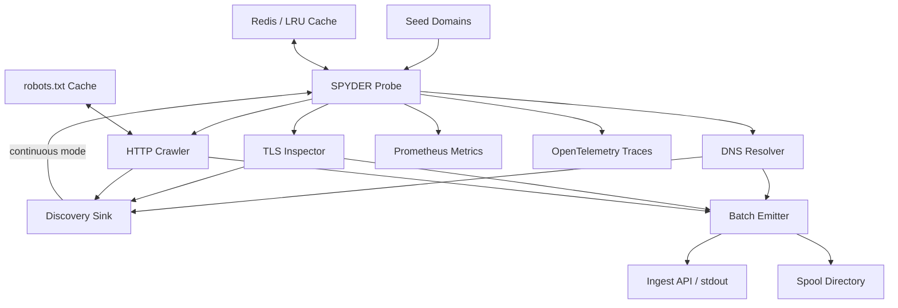

# SPYDER

[](https://github.com/gustycube/spyder/actions/workflows/ci.yml)
[](https://go.dev/)
[](https://goreportcard.com/report/github.com/GustyCube/spyder)
[](https://github.com/gustycube/spyder/pkgs/container/spyder)
[](https://gustycube.github.io/spyder/)
[](LICENSE)
[](https://github.com/GustyCube/spyder/issues)
[](CONTRIBUTING.md)
[](https://opentelemetry.io/)
[](https://prometheus.io/)

**System for Probing and Yielding DNS-based Entity Relations** -- a distributed network reconnaissance tool for mapping inter-domain relationships through DNS resolution, TLS certificate chain analysis, and HTTP link extraction.

## Architecture



## Features

- **Multi-protocol discovery** -- DNS (A/AAAA, CNAME, MX, NS), TLS certificate chains, HTTP link extraction
- **Recursive crawling** -- discovered domains feed back into the work queue with `-continuous` mode
- **Configurable concurrency** -- worker pool with per-host token bucket rate limiting
- **Deduplication** -- in-memory LRU or Redis-backed for distributed deployments
- **Policy compliance** -- RFC-compliant robots.txt parsing, configurable TLD exclusions
- **Observability** -- Prometheus metrics, OpenTelemetry traces, structured Zap logging
- **Fault tolerance** -- circuit breaker pattern, exponential backoff, disk-based spool for failed deliveries
- **Secure transport** -- full mTLS support with CA bundle validation for ingest endpoints
- **Cloud-native** -- distroless container images, Kubernetes health checks, Redis work queues

## Quick Start

```bash
# Build
make build

# Basic scan (single pass)
echo -e "example.com\ngithub.com\ncloudflare.com" > domains.txt
./bin/spyder -domains=domains.txt -concurrency=64

# Recursive crawling (discovers and follows new domains)
./bin/spyder -domains=domains.txt -continuous -max_domains=10000

# With Redis deduplication
REDIS_ADDR=127.0.0.1:6379 ./bin/spyder -domains=domains.txt -concurrency=256

# Docker
docker compose up -d
```

## Configuration

### CLI Flags

| Flag | Default | Description |
|------|---------|-------------|
| `-domains` | *required* | Path to newline-delimited domain list |
| `-config` | | Path to YAML/JSON config file |
| `-concurrency` | `256` | Worker goroutines |
| `-continuous` | `false` | Enable recursive domain discovery |
| `-max_domains` | `0` | Max discovered domains in continuous mode (0 = unlimited) |
| `-ingest` | | HTTP(S) ingest endpoint (empty = stdout) |
| `-probe` | `local-1` | Probe identifier |
| `-run` | `run-{timestamp}` | Run identifier |
| `-ua` | `SPYDERProbe/1.0` | User-Agent string |
| `-exclude_tlds` | `gov,mil,int` | TLDs to skip |
| `-metrics_addr` | `:9090` | Prometheus metrics address |
| `-output_format` | `json` | Output format: json, jsonl, csv |
| `-mtls_cert` | | Client certificate for mTLS |
| `-mtls_key` | | Client key for mTLS |
| `-mtls_ca` | | CA bundle for mTLS |
| `-otel_endpoint` | | OTLP HTTP endpoint |

### Environment Variables

| Variable | Description |
|----------|-------------|
| `REDIS_ADDR` | Redis for deduplication |
| `REDIS_QUEUE_ADDR` | Redis for distributed work queue |
| `REDIS_QUEUE_KEY` | Queue key name (default: `spyder:queue`) |
| `LOG_LEVEL` | Log level: debug, info, warn, error |

## Output Format

```json
{
  "probe_id": "prod-us-east-1",
  "run_id": "run-20240101",
  "nodes_domain": [
    {"host": "example.com", "apex": "example.com", "first_seen": "...", "last_seen": "..."}
  ],
  "nodes_ip": [
    {"ip": "93.184.216.34", "first_seen": "...", "last_seen": "..."}
  ],
  "nodes_cert": [
    {"spki_sha256": "a1b2c3...", "subject_cn": "*.example.com", "issuer_cn": "DigiCert", "not_before": "...", "not_after": "..."}
  ],
  "edges": [
    {"type": "RESOLVES_TO", "source": "example.com", "target": "93.184.216.34", "observed_at": "...", "probe_id": "...", "run_id": "..."}
  ]
}
```

### Edge Types

| Type | Source | Target | Discovery Method |
|------|--------|--------|-----------------|
| `RESOLVES_TO` | Domain | IP | DNS A/AAAA |
| `USES_NS` | Domain | Nameserver | DNS NS |
| `ALIAS_OF` | Domain | Domain | DNS CNAME |
| `USES_MX` | Domain | Mail server | DNS MX |
| `LINKS_TO` | Domain | Domain | HTTP link extraction |
| `USES_CERT` | Domain | SPKI hash | TLS handshake |

## Deployment

### Docker Compose

The included `docker-compose.yml` starts SPYDER with Redis, Prometheus, and Grafana:

```bash
docker compose up -d        # start all services
docker compose logs -f spyder  # follow probe logs
```

### Distributed Mode

Use Redis work queues for multi-instance deployments:

```bash
# Seed the queue
./bin/seed -redis=redis:6379 -domains=domains.txt

# Run multiple probes
REDIS_QUEUE_ADDR=redis:6379 ./bin/spyder -probe=probe-1 -continuous
REDIS_QUEUE_ADDR=redis:6379 ./bin/spyder -probe=probe-2 -continuous
```

## Documentation

Full documentation at **[gustycube.github.io/spyder](https://gustycube.github.io/spyder/)**

```bash
# Run docs locally
cd docs && npm install && npm run docs:dev
```

## Contributing

See [CONTRIBUTING.md](CONTRIBUTING.md). Quick setup:

```bash
git clone https://github.com/gustycube/spyder.git
cd spyder
make lint test build
```

## License

[MIT](LICENSE)
